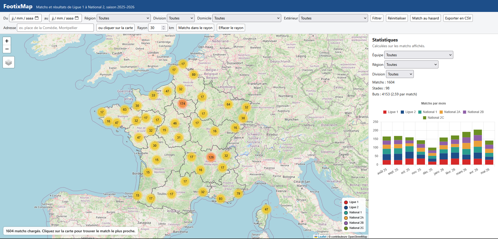

# FootixMap

Carte web des matchs de football de la Ligue 1 à la National 2, saison 2025-2026, avec les scores : trouver un match près de chez soi, voir où une équipe a joué, comparer les régions.

**Démo : https://labcoqarm.github.io/footixmap/**



1 604 matchs dans 98 stades, répartis sur six divisions : Ligue 1, Ligue 2, National 1 et les trois poules de National 2 (A, B, C). Chaque match est placé sur le stade de l'équipe qui reçoit, avec sa date, son horaire et son score officiel.

## Ce que fait la carte

- filtrer par dates, région, division, équipe à domicile ou à l'extérieur ;
- chercher une adresse (Base Adresse Nationale) ou cliquer un point, puis garder les matchs dans un rayon donné en kilomètres ;
- cliquer n'importe où pour obtenir le match le plus proche et sa distance à vol d'oiseau ;
- tirer un match au hasard parmi ceux affichés ;
- exporter la sélection en CSV ;
- suivre le nombre de matchs, de stades et de buts, avec un histogramme mensuel par division ; pour une équipe, le bilan victoires, nuls, défaites et buts marqués ou encaissés.

## Organisation du dépôt

```
index.html, css/, js/          application web (Leaflet, Leaflet.markercluster, Turf, Chart.js)
data/matchs.geojson            matchs et scores géolocalisés, lus par la carte
data/regions.geojson           contours des 13 régions métropolitaines
donnees/                       tableaux source, correspondance des noms d'équipes, corrections de stades
R/geocoder_stades.R            géocodage des stades avec Nominatim
outils/extraire_scores_fff.js  calendriers, horaires et scores depuis l'API publique de la FFF (console du navigateur)
R/preparer_donnees.R           assemblage et export de data/matchs.geojson
```

## Chaîne de préparation des données

1. Les calendriers des six championnats ont d'abord été rassemblés dans un tableur (`donnees/BDD_FOOT.csv`, puis `donnees/matchs_geocodes.csv`).
2. `R/geocoder_stades.R` interroge Nominatim (OpenStreetMap) une fois par stade, avec un cache et une pause d'une seconde entre deux requêtes, puis retrouve la commune par géocodage inverse. Nominatim demande un User-Agent identifiable, à définir dans la variable d'environnement `NOMINATIM_UA`.
3. `outils/extraire_scores_fff.js` lit l'API publique de la FFF (`api-dofa.fff.fr`), qui couvre aussi la Ligue 1 et la Ligue 2, et produit `donnees/scores_fff_2025_2026.csv` : journée, date, horaire, score et terrain de chaque match. L'API refuse les requêtes faites hors navigateur (erreur 403 depuis R), le script se colle donc dans la console (F12) d'un onglet ouvert sur `https://api-dofa.fff.fr/api/compets/439449`. Les noms des arbitres et délégués, présents dans l'API, ne sont pas gardés.
4. `R/preparer_donnees.R` part des matchs FFF, traduit les noms d'équipes avec `donnees/correspondance_equipes.csv`, rattache chaque match au stade du club qui reçoit et écrit `data/matchs.geojson`.

La confrontation avec la FFF a fait ressortir plusieurs erreurs dans les données d'origine :

- en Ligue 2 et en National 1, plus de 280 matchs par division n'avaient ni la bonne journée ni la bonne date, ce qui ressemble à un calendrier provisoire. La FFF fait désormais référence pour les dates, les horaires et les journées ;
- AC Ajaccio apparaissait en Ligue 2 et en National 1, mais ne figure dans aucun des deux championnats côté FFF : la Ligue 2 compte l'US Boulogne à sa place, et le National s'est joué à 17 clubs, avec un exempt à chaque journée (les 34 lignes « AC Ajaccio » de National 1 sont retirées) ;
- six stades placés sur un homonyme par Nominatim (le Parc des Sports de Haguenau atterrissait à Annecy, le stade Auguste-Delaune de Bobigny à Reims, le stade Pierre-de-Coubertin de Cannes à Paris...), et le GFA Rumilly-Vallières placé au stade de la Duchère à Lyon ;
- les Girondins de Bordeaux et le Fleury 91 FC ont joué la plupart de leurs matchs à domicile ailleurs que dans le stade géocodé (Matmut Atlantique, Essonne Stadium).

Les coordonnées corrigées ou ajoutées, avec leur source, sont dans `donnees/corrections_stades.csv`. Les scores de Ligue 1 ont été comparés à ceux d'[openfootball](https://github.com/openfootball/europe) : même distribution des 306 scores et même total de 863 buts.

Pour tout régénérer : lancer `outils/extraire_scores_fff.js` dans le navigateur, placer le CSV téléchargé dans `donnees/`, ouvrir `footixmap.Rproj` puis lancer `R/preparer_donnees.R` (package `sf`).

## Lancer la carte en local

Le navigateur refuse de lire les GeoJSON depuis un fichier ouvert en double-clic (`file://`). Il faut un petit serveur, par exemple depuis la racine du dépôt :

```
python -m http.server 8000
```

puis ouvrir http://localhost:8000.

## Version 3-tiers avec GeoServer

Le projet a d'abord été construit en architecture 3-tiers : PostgreSQL/PostGIS pour les données, GeoServer pour les servir en WFS, Leaflet pour l'affichage. Ce mode reste disponible : publier `matchs` et `regions` dans un espace de travail `footix`, activer CORS sur GeoServer, puis passer `source: "geoserver"` dans `js/config.js`. La version en ligne lit directement les fichiers GeoJSON, ce qui permet de l'héberger sur GitHub Pages sans serveur.

## Limites

- Un point par club : quand un match s'est joué ailleurs que dans le stade habituel (par exemple les premiers matchs à domicile du FC Annecy à Dijon), le point reste au stade du club et la fiche du match indique le terrain déclaré à la FFF.
- Un match de Ligue 2 (SC Bastia - Stade Lavallois) n'a pas de score dans l'API de la FFF ; il est affiché comme « score non communiqué ».
- Les distances sont à vol d'oiseau, pas des temps de trajet.

## Sources

- Fonds de carte : © contributeurs [OpenStreetMap](https://www.openstreetmap.org/copyright), imagerie Esri.
- Géocodage des stades : [Nominatim](https://nominatim.org/), corrections manuelles documentées dans `donnees/corrections_stades.csv`.
- Calendriers, horaires et scores : Fédération française de football, API publique `api-dofa.fff.fr`, données récupérées en novembre 2026.
- Recherche d'adresse : [API Adresse](https://adresse.data.gouv.fr/) (Base Adresse Nationale).
- Contours des régions : [france-geojson](https://github.com/gregoiredavid/france-geojson), version simplifiée.

Projet réalisé en binôme dans le cours de webmapping du Master Géomatique (M2), remis au propre pour GitHub.
